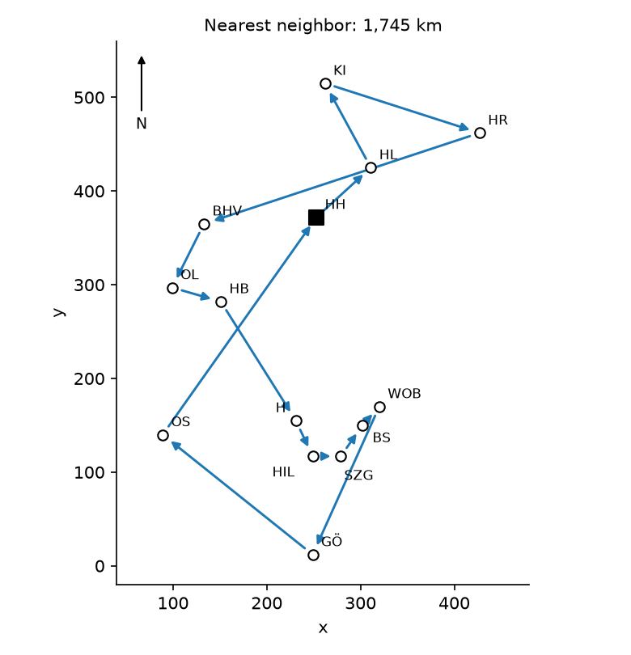
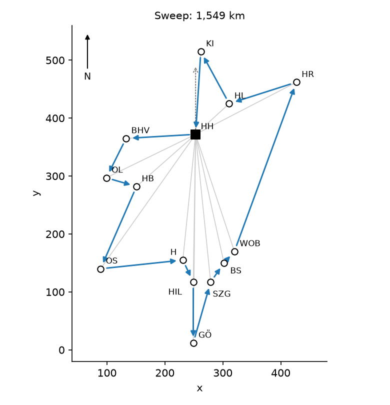
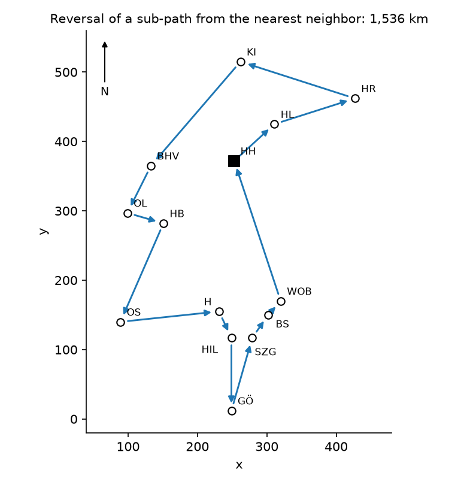

# Round trip of a sales representative through 14 cities

A sales representative leaves Hamburg, visits 13 other cities of northern Germany once each and returns to Hamburg. This document builds her route with two construction heuristics, the nearest neighbor and the sweep, and shortens it with a local search with two moves: the swap of two adjacent cities and the reversal of a sub-path. It then calculates the shortest route exactly, measures how far each heuristic is from it, and shows that where a local search stops depends on the move and on the starting route. The case is the traveling salesman problem of Ivanov et al. (2025, §14.3). The document contains all the data and all the results, so that anyone can follow and check them.

## 1. Round trip of a sales representative

The sales representative starts in Hamburg (HH), visits each of the other 13 cities of Table 1 once and ends in Hamburg. She looks for the shortest route.

Table 1. The 14 cities and their coordinates (Ivanov et al., 2025, Table 14.3)

| *i* | City | Abbreviation | *x* | *y* |
|---|---|---|---|---|
| 1 | Hamburg | HH | 253 | 372 |
| 2 | Bremen | HB | 151 | 282 |
| 3 | Hannover | H | 231 | 155 |
| 4 | Braunschweig | BS | 302 | 150 |
| 5 | Kiel | KI | 262 | 515 |
| 6 | Lübeck | HL | 311 | 425 |
| 7 | Rostock | HR | 427 | 462 |
| 8 | Osnabrück | OS | 89 | 140 |
| 9 | Oldenburg | OL | 99 | 297 |
| 10 | Wolfsburg | WOB | 320 | 170 |
| 11 | Göttingen | GÖ | 249 | 12 |
| 12 | Bremerhaven | BHV | 133 | 365 |
| 13 | Hildesheim | HIL | 249 | 117 |
| 14 | Salzgitter | SZG | 279 | 117 |

Table 2 gives the distance $d_{ij}$ between each pair of cities, in kilometers. The distances are symmetric, $d_{ij} = d_{ji}$. Each one is the straight-line distance between the coordinates of the two cities in Table 1, rounded to the nearest kilometer; the largest difference between the two is 0.49 km. The lengths of the routes are calculated with Table 2. The coordinates are used only to draw the maps and, in §4, for the angle of each city seen from Hamburg.

Table 2. Distance between each pair of cities, $d_{ij}$ (km) (Ivanov et al., 2025, Fig. 14.4)

| | HH | HB | H | BS | KI | HL | HR | OS | OL | WOB | GÖ | BHV | HIL | SZG |
|---|---|---|---|---|---|---|---|---|---|---|---|---|---|---|
| **HH** | – | 136 | 218 | 227 | 143 | 79 | 196 | 284 | 171 | 213 | 360 | 120 | 255 | 256 |
| **HB** | 136 | – | 150 | 201 | 258 | 215 | 330 | 155 | 54 | 203 | 287 | 85 | 192 | 209 |
| **H** | 218 | 150 | – | 71 | 361 | 282 | 364 | 143 | 194 | 90 | 144 | 232 | 42 | 61 |
| **BS** | 227 | 201 | 71 | – | 367 | 275 | 336 | 213 | 251 | 27 | 148 | 273 | 62 | 40 |
| **KI** | 143 | 258 | 361 | 367 | – | 102 | 173 | 413 | 272 | 350 | 503 | 198 | 398 | 398 |
| **HL** | 79 | 215 | 282 | 275 | 102 | – | 122 | 361 | 248 | 255 | 418 | 188 | 314 | 310 |
| **HR** | 196 | 330 | 364 | 336 | 173 | 122 | – | 467 | 367 | 311 | 484 | 310 | 388 | 375 |
| **OS** | 284 | 155 | 143 | 213 | 413 | 361 | 467 | – | 157 | 233 | 205 | 229 | 162 | 191 |
| **OL** | 171 | 54 | 194 | 251 | 272 | 248 | 367 | 157 | – | 255 | 322 | 76 | 234 | 255 |
| **WOB** | 213 | 203 | 90 | 27 | 350 | 255 | 311 | 233 | 255 | – | 173 | 270 | 89 | 67 |
| **GÖ** | 360 | 287 | 144 | 148 | 503 | 418 | 484 | 205 | 322 | 173 | – | 372 | 105 | 109 |
| **BHV** | 120 | 85 | 232 | 273 | 198 | 188 | 310 | 229 | 76 | 270 | 372 | – | 274 | 288 |
| **HIL** | 255 | 192 | 42 | 62 | 398 | 314 | 388 | 162 | 234 | 89 | 105 | 274 | – | 30 |
| **SZG** | 256 | 209 | 61 | 40 | 398 | 310 | 375 | 191 | 255 | 67 | 109 | 288 | 30 | – |

### Route and its length

A route is the sequence of cities $r_0, r_1, \dots, r_{14}$ in the order of visit, with $r_0 = r_{14} = \text{HH}$ and each of the other 13 cities once in positions 1 to 13. Its length is the sum of the distances between consecutive cities:

$$
L(r) = \sum_{k=0}^{13} d_{r_k r_{k+1}}
$$

### Number of routes

The first city after Hamburg can be any of the 13; the second, any of the 12 left; and so on. There are $13! = 6{,}227{,}020{,}800$ orders of visit (Ivanov et al., 2025, §14.3.1). Since the distances are symmetric, a route and the same route in the other direction have the same length, so there are $13!/2 = 3{,}113{,}510{,}400$ different round trips.

## 2. Exact and heuristic algorithms

An **exact algorithm** returns a solution and proves that no other feasible solution is better. A **heuristic** returns a feasible solution by following a reasonable strategy, without proving that no other solution is better (Ivanov et al., 2025, §14.3.3). A heuristic is used when no exact algorithm is available or when the exact algorithm would take too long for the decision.

Ivanov et al. (2025, §14.3.3) distinguish two kinds of heuristics for the traveling salesman problem:

- a **construction heuristic** builds a first feasible route, adding one city at a time;
- an **improvement heuristic** starts from a feasible route and changes it, keeping it feasible, to make it shorter.

A **greedy** heuristic is a construction heuristic that, at each step, takes the option that looks best at that moment, without considering how it affects the later steps. Not every construction heuristic is greedy: the nearest neighbor (§3) is greedy, and the sweep (§4) is not.

## 3. Nearest neighbor

### Rule of the nearest neighbor

From Hamburg, go each time to the nearest city not yet visited; when every city has been visited, return to Hamburg (Ivanov et al., 2025, §14.3.3, where it is called the greedy construction procedure). It is greedy: each step takes the shortest leg available. In this case no step has two cities at the same distance.

Table 3 gives the route, leg by leg.

Table 3. Route of the nearest neighbor (km)

| Leg | From | To | Distance | So far |
|---|---|---|---|---|
| 1 | HH | HL | 79 | 79 |
| 2 | HL | KI | 102 | 181 |
| 3 | KI | HR | 173 | 354 |
| 4 | HR | BHV | 310 | 664 |
| 5 | BHV | OL | 76 | 740 |
| 6 | OL | HB | 54 | 794 |
| 7 | HB | H | 150 | 944 |
| 8 | H | HIL | 42 | 986 |
| 9 | HIL | SZG | 30 | 1,016 |
| 10 | SZG | BS | 40 | 1,056 |
| 11 | BS | WOB | 27 | 1,083 |
| 12 | WOB | GÖ | 173 | 1,256 |
| 13 | GÖ | OS | 205 | 1,461 |
| 14 | OS | HH | 284 | 1,745 |

The route is HH, HL, KI, HR, BHV, OL, HB, H, HIL, SZG, BS, WOB, GÖ, OS, HH, with a length of 1,745 km.

### Defect of the nearest neighbor

Each step looks only at the next leg; the way back to Hamburg is not taken into account until every city has been visited (Ivanov et al., 2025, §14.3.3). The last cities are the ones left over, wherever they are. Here the route ends in the south, at Göttingen, and has to cross to Osnabrück and then back north to Hamburg: the last two legs, 205 km and 284 km, are 489 km, 28 % of the route.

## 4. Sweep

### Rule of the sweep

Order the cities by the angle of the line that joins them with Hamburg, measured from north (+*y*) counterclockwise, from the smallest to the largest, and visit them in that order. Table 4 gives the angles. Bremerhaven, almost due west of Hamburg, has an angle of 93.3°; Göttingen, almost due south, 179.4°; Kiel, a little east of due north, 356.4°.

Ivanov et al. (2025, §14.4.5) present the sweep, after Gillett and Miller (1974), for routes of several vehicles with a limited capacity: the cities are taken in the order of their angle and assigned to a vehicle until its capacity is full; then the next vehicle starts. Applying it to a single vehicle without a capacity, so that the order of the angles is the whole route, is a choice of this case.

The sweep is a construction heuristic, and it is not greedy: the whole order is fixed by the angles before the first leg, and no distance is compared.

Table 4. Order of the sweep: angle of each city seen from Hamburg, from north, counterclockwise (degrees)

| Order | City | Angle |
|---|---|---|
| 1 | BHV | 93.3 |
| 2 | OL | 116.0 |
| 3 | HB | 131.4 |
| 4 | OS | 144.7 |
| 5 | H | 174.2 |
| 6 | HIL | 179.1 |
| 7 | GÖ | 179.4 |
| 8 | SZG | 185.8 |
| 9 | BS | 192.4 |
| 10 | WOB | 198.3 |
| 11 | HR | 297.3 |
| 12 | HL | 312.4 |
| 13 | KI | 356.4 |

The route is HH, BHV, OL, HB, OS, H, HIL, GÖ, SZG, BS, WOB, HR, HL, KI, HH, with a length of 1,549 km: 196 km shorter than the nearest neighbor. The route goes round Hamburg once, west, south, east and north, and ends at Kiel, 143 km from Hamburg.

## 5. Local search

A local search is an improvement heuristic. It starts from a route and changes it one move at a time, looking in the neighborhood of the current route for a shorter one (Klein and Faust, 2015, §31.5):

- **A move** changes a route into another feasible route.
- **The neighborhood** of a route is the set of routes that one move reaches.
- **A local optimum** is a route with no shorter route in its neighborhood.

Klein and Faust (2015, §31.5) note that a local search finds local optima quickly, and that it explores little of the set of solutions beyond the neighborhoods it goes through. The search of this case uses the best improvement: at each step it evaluates every move of the neighborhood and makes the one that leaves the shortest route, if it is strictly shorter than the current route; if two moves leave routes of the same length, it makes the first one in the order of evaluation. It stops when no move shortens the route, at a local optimum.

### Moves of the local search

Both reverse the cities of the route from position $i$ to position $j$:

- **swap of two adjacent cities:** positions $k$ and $k + 1$, with $k = 1, \dots, 12$, evaluated in that order: 12 moves;
- **reversal of a sub-path:** positions $i$ to $j$, with $1 \le i < j \le 13$, evaluated in increasing order of $i$ and, for each $i$, in increasing order of $j$: 78 moves.

The swap of two adjacent cities is the reversal of a sub-path of two cities, so its neighborhood is part of that of the reversal. Reversing positions $i$ to $j$ takes out two arcs, $(r_{i-1}, r_i)$ and $(r_j, r_{j+1})$, and puts in two, $(r_{i-1}, r_j)$ and $(r_i, r_{j+1})$. The arcs inside the sub-path stay, traveled in the other direction, and with symmetric distances their length does not change. The change in the length of the route is therefore

$$
\Delta L = d_{r_{i-1} r_j} + d_{r_i r_{j+1}} - d_{r_{i-1} r_i} - d_{r_j r_{j+1}}
$$

the two arcs that come in minus the two that go out. The move shortens the route if $\Delta L < 0$. Reversing positions 1 to 13 gives the same route in the other direction, with $\Delta L = 0$.

### Pass of Ivanov et al.

Ivanov et al. (2025, §14.3.3, iterations 1 to 12) improve the route of the nearest neighbor by swapping adjacent cities in a single pass. For $k = 1, \dots, 12$, they compare the sub-path of four cities at positions $k - 1$ to $k + 2$ with the same sub-path with the cities at $k$ and $k + 1$ swapped, and keep the swap if the sub-path gets shorter. Only the three arcs of that sub-path change, so comparing the sub-paths is the same as comparing the routes. The pass goes on from the route already changed. It differs from the local search above: it makes the first swap that shortens the route at each position, instead of the best one in the neighborhood, and it goes through the positions once.

Table 5. Pass of Ivanov et al. from the route of the nearest neighbor: length of the sub-path before and after the swap (km)

| Iteration | Sub-path | Before | After the swap | Swap kept |
|---|---|---|---|---|
| 1 | HH, HL, KI, HR | 354 | 367 | |
| 2 | HL, KI, HR, BHV | 585 | 493 | yes |
| 3 | HR, KI, BHV, OL | 447 | 780 | |
| 4 | KI, BHV, OL, HB | 328 | 433 | |
| 5 | BHV, OL, HB, H | 280 | 333 | |
| 6 | OL, HB, H, HIL | 246 | 536 | |
| 7 | HB, H, HIL, SZG | 222 | 295 | |
| 8 | H, HIL, SZG, BS | 112 | 153 | |
| 9 | HIL, SZG, BS, WOB | 97 | 169 | |
| 10 | SZG, BS, WOB, GÖ | 240 | 242 | |
| 11 | BS, WOB, GÖ, OS | 405 | 554 | |
| 12 | WOB, GÖ, OS, HH | 662 | 798 | |

Only the swap of iteration 2, KI and HR, is kept. After the pass, the route is HH, HL, HR, KI, BHV, OL, HB, H, HIL, SZG, BS, WOB, GÖ, OS, HH, with a length of 1,653 km: 92 km shorter than the nearest neighbor.

### Differences with Ivanov et al.

Four numbers of Ivanov et al. (2025, §14.3.3) differ from those obtained with their own distance matrix (Table 2). The routes and the decisions of the pass are the same.

Table 6. Numbers of Ivanov et al. (2025) and the same numbers with the distances of Table 2 (km)

| | Ivanov et al. (2025) | With Table 2 |
|---|---|---|
| Route of the nearest neighbor | 1,746 | 1,745 |
| Iteration 2, sub-path HL, KI, HR, BHV | 605 | 585 (102 + 173 + 310) |
| Iteration 6, sub-path OL, HB, H, HIL | 264 | 246 (54 + 150 + 42) |
| Reduction of the pass | 112 | 92 |

### Swap of two adjacent cities from the nearest neighbor

The search makes one step, the swap of KI and HR, and reaches the route of the pass, 1,653 km. There it stops: the best of the 12 swaps gives a route of 1,655 km.

### Reversal of a sub-path from the nearest neighbor

The search makes five steps (Table 7). The first is the same swap of KI and HR. The second reverses the seven cities from Hannover to Osnabrück, which is the reversal that Ivanov et al. (2025, Fig. 14.8) show, without naming the move: it takes out the legs HB–H (150 km) and OS–HH (284 km) and puts in HB–OS (155 km) and H–HH (218 km), so the route gets 61 km shorter.

Table 7. Local search with the reversal of a sub-path from the route of the nearest neighbor

| Step | Sub-path reversed | Arcs out | Arcs in | Length (km) |
|---|---|---|---|---|
| 0 | — (nearest neighbor) | — | — | 1,745 |
| 1 | KI, HR | HL–KI; HR–BHV | HL–HR; KI–BHV | 1,653 |
| 2 | H, HIL, SZG, BS, WOB, GÖ, OS | HB–H; OS–HH | HB–OS; H–HH | 1,592 |
| 3 | WOB, BS, SZG, HIL, H | GÖ–WOB; H–HH | GÖ–H; WOB–HH | 1,558 |
| 4 | H, HIL | GÖ–H; HIL–SZG | GÖ–HIL; H–SZG | 1,550 |
| 5 | GÖ, HIL, H | OS–GÖ; H–SZG | OS–H; GÖ–SZG | 1,536 |

The sub-path reversed is written in its order before the move. The search stops at HH, HL, HR, KI, BHV, OL, HB, OS, H, HIL, GÖ, SZG, BS, WOB, HH, with a length of 1,536 km: no reversal of a sub-path shortens it. The route of the swaps, 1,653 km, is a local optimum for the swap of two adjacent cities and not for the reversal of a sub-path: the reversal of step 2 is not a swap.

### Reversal of a sub-path from the sweep

The search makes one step: it reverses HL, KI, which takes out HR–HL and KI–HH and puts in HR–KI and HL–HH. It stops at HH, BHV, OL, HB, OS, H, HIL, GÖ, SZG, BS, WOB, HR, KI, HL, HH, with a length of 1,536 km.

## 6. Shortest route and local optima

### Shortest route

The shortest route has been calculated with dynamic programming over subsets of cities. For each set $S$ of cities other than Hamburg and each city $j$ of $S$, $B(S, j)$ is the length of the shortest path that leaves Hamburg, visits every city of $S$ once and ends at $j$. With one city, $B(\{j\}, j) = d_{\text{HH}\,j}$. With more, the path to $j$ comes from the best of the other cities $k$ of $S$:

$$
B(S, j) = \min_{k \in S \setminus \{j\}} \big( B(S \setminus \{j\}, k) + d_{kj} \big)
$$

and the shortest route is $\min_j \big( B(\text{all 13 cities}, j) + d_{j\,\text{HH}} \big)$. The calculation goes through the $2^{13} = 8{,}192$ subsets of the 13 cities, from the smallest to the set of all 13, and takes less than a second without a solver. It is an exact algorithm (§2): no route is left out, because the shortest path through $S$ that ends at $j$ starts with the shortest path through $S \setminus \{j\}$ that ends at the city before $j$.

The shortest route is 1,536 km. Two different round trips have that length, four routes counting each one in both directions:

- HH, BHV, OL, HB, OS, H, HIL, GÖ, SZG, BS, WOB, HR, KI, HL, HH;
- HH, HL, HR, KI, BHV, OL, HB, OS, H, HIL, GÖ, SZG, BS, WOB, HH.

They share 11 of their 14 arcs. The first has HH–BHV, WOB–HR and KI–HL (120 + 311 + 102 = 533 km); the second has HL–HR, KI–BHV and WOB–HH (122 + 198 + 213 = 533 km). The local search with the reversal of a sub-path reaches the second from the nearest neighbor (§5) and the first from the sweep.

Table 8 gives each route of §3 to §5 against the shortest route.

Table 8. Length of each route and how far it is above the shortest route, 1,536 km

| Route | Length (km) | Above the shortest (%) |
|---|---|---|
| Nearest neighbor | 1,745 | 13.6 |
| Sweep | 1,549 | 0.8 |
| Pass of Ivanov et al. from the nearest neighbor | 1,653 | 7.6 |
| Swap of two adjacent cities from the nearest neighbor | 1,653 | 7.6 |
| Reversal of a sub-path from the nearest neighbor | 1,536 | 0.0 |
| Reversal of a sub-path from the sweep | 1,536 | 0.0 |

### Local optima from random routes

The search with the reversal of a sub-path has been started from 20,000 routes that visit the 13 cities in random order. Table 9 gives, for each length where the search stops, how many starting routes stop there. The random routes are drawn with Python, after `random.seed(1)`, as `random.shuffle` of the list of cities 2 to 14; with another way of drawing them, the counts would be different.

Table 9. Where the local search with the reversal of a sub-path stops, from 20,000 random starting routes

| Length where it stops (km) | Starting routes | % |
|---|---|---|
| 1,536 | 15,144 | 75.7 |
| 1,554 | 1,785 | 8.9 |
| 1,572 | 758 | 3.8 |
| 1,587 | 320 | 1.6 |
| 1,588 | 1,241 | 6.2 |
| 1,603 | 323 | 1.6 |
| 1,610 | 370 | 1.9 |
| 1,622 | 40 | 0.2 |
| 1,637 | 19 | 0.1 |

The search stops at nine different lengths. Three starts in four reach the shortest route; the other 4,856 (24.3 %) stop at a local optimum up to 101 km longer, from which no reversal of a sub-path leads to a shorter route.

### Dependence on the move and the starting route

It depends on the move and on the starting route. From the same route of the nearest neighbor, the swap of two adjacent cities stops at 1,653 km and the reversal of a sub-path at 1,536 km; with the reversal of a sub-path, the random starts of Table 9 stop at nine different lengths. A local optimum is only the best route of its own neighborhood. The search cannot tell whether the route where it stops is the shortest one: here the routes of 1,536 km are known to be the shortest because the dynamic programming above proves it, not because the search stopped there.

## 7. Reproducing the numbers

Two Python scripts in this folder reproduce the tables of this document. Running them is optional: it is support material, not part of what is assessed. How to run each one is explained at the top of the file.

| Script | What it prints | What must be installed |
|---|---|---|
| `traveling_salesman_heuristics.py` | The route of the nearest neighbor (Table 3), the order and the route of the sweep (Table 4), the pass of Ivanov et al. (Table 5) and the local search from the nearest neighbor with each move (Table 7) and from the sweep with the reversal of a sub-path | Nothing beyond Python |
| `traveling_salesman_local_optima.py` | The shortest route and the routes with that length, each heuristic against it (Table 8), and where the local search stops from 20,000 random routes (Table 9). The number of random routes and the seed are set at the top of the script | Nothing beyond Python |

The notebook [`notebooks/traveling_salesman.ipynb`](notebooks/traveling_salesman.ipynb) goes through §1–§6 step by step, with forms to choose the starting route of the local search (nearest neighbor, sweep, or a random route with its seed) and the move, to see the search step by step on the map with the arcs that come in and go out, and to change the number of random starting routes of Table 9. It opens in Google Colab without installing anything: . Its code is in the package `routes` of this folder (`src/routes/`), which also draws the maps of this document.

## References

Ivanov, D., Tsipoulanidis, A., & Schönberger, J. (2025). *Global supply chain and operations management: A decision-oriented introduction to the creation of value* (4th ed.). Springer. https://doi.org/10.1007/978-3-031-95859-5

Klein, R., & Faust, O. (2015). Genetic algorithms. In H. Stadtler, C. Kilger, & H. Meyr (Eds.), *Supply chain management and advanced planning: Concepts, models, software, and case studies* (5th ed., pp. 537–544). Springer. https://doi.org/10.1007/978-3-642-55309-7

---

The cities, their coordinates and the distances are those of Ivanov et al. (2025, Table 14.3 and Fig. 14.4).
